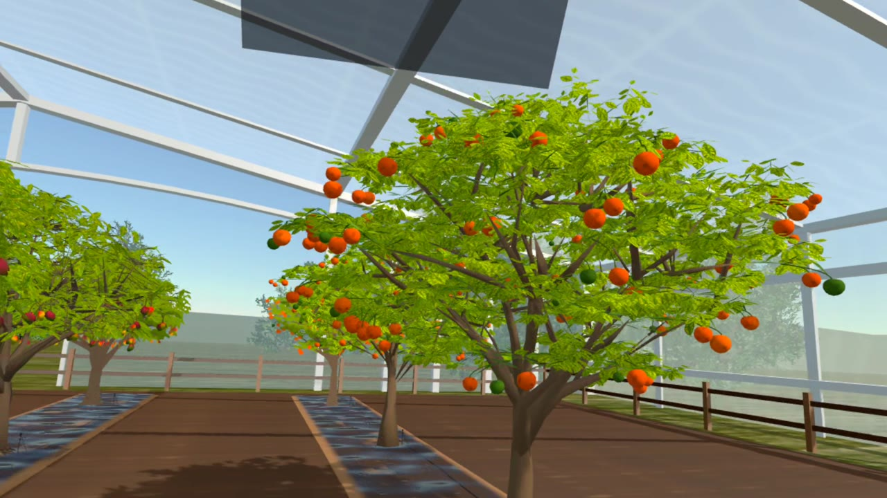
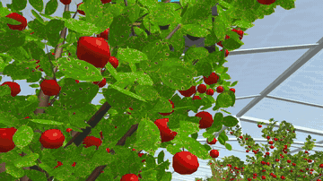
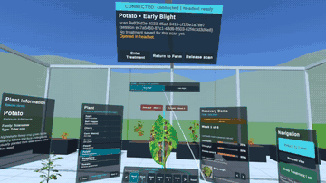
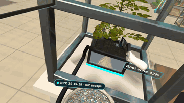
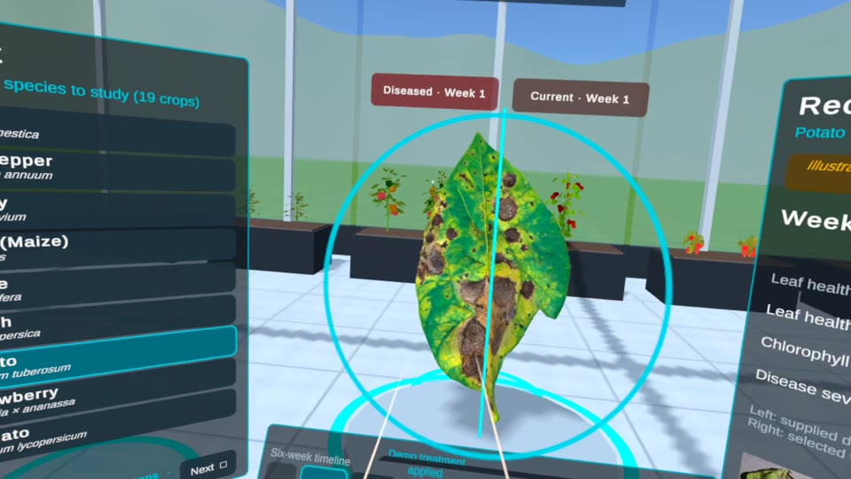
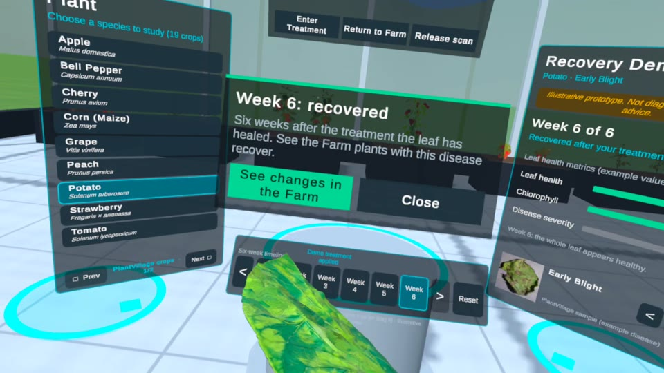
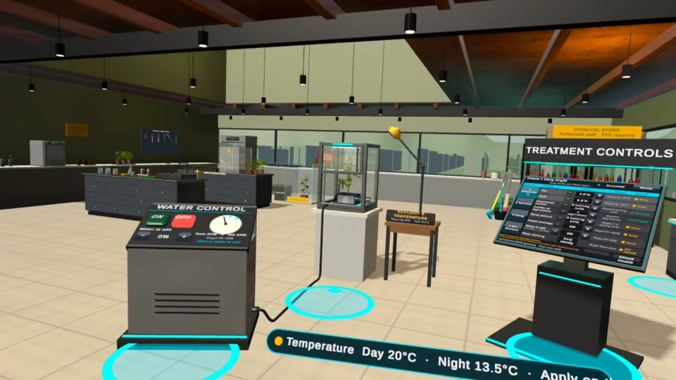
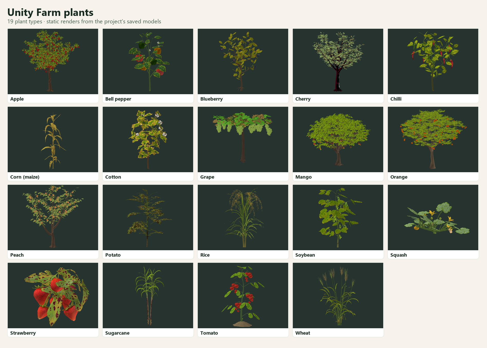

# CropScan XR

**Plant disease inspection and treatment training in Unity VR**

CropScan XR combines a leaf-photo scanner with a virtual Farm, Lab, and Treatment scene. Learners can inspect a plant, examine its symptoms up close, apply a simulated treatment, and follow the specimen through a six-week recovery timeline. The Unity experience supports standalone lessons and can open a mapped case from the scanner.

[VR demo clips](#vr-demo-clips) · [Quick start](#quick-start) · [Evaluation report](Evaluation/CropScan-XR-Report.pdf)



## VR demo clips

Select a preview to open its clip. The footage comes from the Quest demonstration.

| Farm | Lab and recovery | Treatment |
| --- | --- | --- |
| [](Docs/VR-Demo/farm.mp4) | [](Docs/VR-Demo/lab.mp4) | [](Docs/VR-Demo/treatment.mp4) |
| [Watch the Farm clip](Docs/VR-Demo/farm.mp4) | [Watch the Lab clip](Docs/VR-Demo/lab.mp4) | [Watch the Treatment clip](Docs/VR-Demo/treatment.mp4) |

## The VR learning flow

1. **Farm.** Walk through the crop beds and select a specimen from the 19-crop collection.
2. **Lab.** Examine visible symptoms on the leaf and step through the recovery timeline.
3. **Treatment.** Use the chamber controls and handheld tools to practise a case. Apply the treatment and check the simulated outcome.
4. **Return to the Farm.** Review the recovery state in the Lab, then return to the selected specimen.

| Leaf inspection in the Lab | Simulated recovery in week six |
| --- | --- |
|  |  |
| **Treatment chamber on Quest** | **Unity plant collection** |
|  |  |

[Browse the Unity screenshot gallery](Docs/Screenshots) · [Download the individual plant images](Docs/Screenshots/unity-farm-plants-2026-11-23/Unity-Farm-Plant-Images.zip)

## Quick start

### Unity and Meta Quest

1. Install Git LFS and clone the project.

   ```bash
   git lfs install
   git clone https://github.com/bhargavm-iiits/VR-Plant-Treatment.git
   cd VR-Plant-Treatment
   git lfs pull
   ```

2. Open the repository root in Unity Hub with Unity **6000.5.5f1**. Open [XRBootstrap](Assets/Scenes/XRBootstrap.unity) and enter Play mode to start the scene flow.
3. For a native headset build, install Unity's Android Build Support, SDK, NDK, and OpenJDK modules. In Unity, choose **BTP → Build → Quest Demo APK**. Install `Builds/Quest/PlantDiseaseVR.apk` on a developer-mode Quest using Meta Quest Developer Hub or `adb install -r Builds/Quest/PlantDiseaseVR.apk`.

[Connected XR setup](Docs/CropScan_XR_Implementation_Guide.md) · [Quest launch and deployment](Backend/DEPLOY.md#native-quest-demo)

### Scanner and API

The [backend guide](Backend/README.md#running-it) covers the FastAPI service, React frontend, and local development with SQLite or Docker. The [XR contract](Docs/CropScan_XR_Unity_Contract.md) describes how a supported scan opens a Unity specimen and how the session tracks its treatment result.

## Project structure

| Directory | Contents |
| --- | --- |
| [Assets/Scenes](Assets/Scenes) | XR bootstrap, Farm, Lab, and Treatment scenes |
| [Assets/_Project](Assets/_Project) | Unity runtime, prefabs, plant data, and EditMode tests |
| [Backend/frontend](Backend/frontend) | React and Vite scanner interface |
| [Backend/services/api](Backend/services/api) | FastAPI, ONNX inference, and XR pairing and sessions |
| [Tools](Tools) | Asset preparation tools and the Windows launcher |
| [Evaluation](Evaluation) | Evaluation report, presentation, and verification notes |

## Evaluation and credits

The Unity project includes **58 authored treatment cases across 19 crops**. The scanner integration maps **24 cases** to Unity specimens. The evaluation report describes the Quest demonstration, the targeted Unity tests, and the team classifier benchmarks. Recovery values represent authored training scenarios.

Bhargav M developed the Unity VR experience and presented the Quest demonstration. A teammate developed the scanner backend.

[Evaluation report](Evaluation/CropScan-XR-Report.pdf) · [Presentation](Evaluation/CropScan-XR-Presentation-Fixed.pptx) · [Repository audit](Evaluation/Repository-Audit.md)
