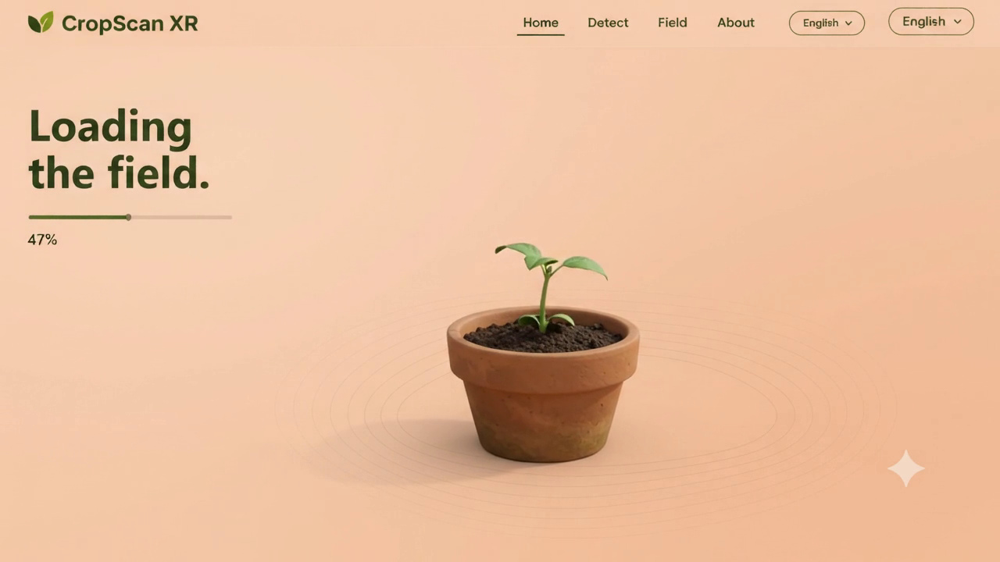
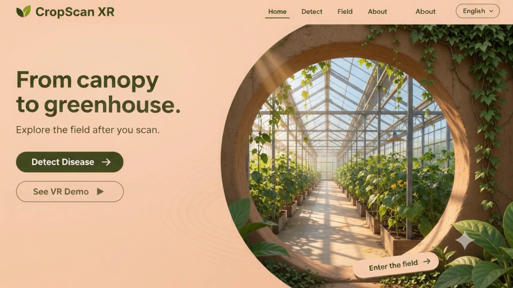
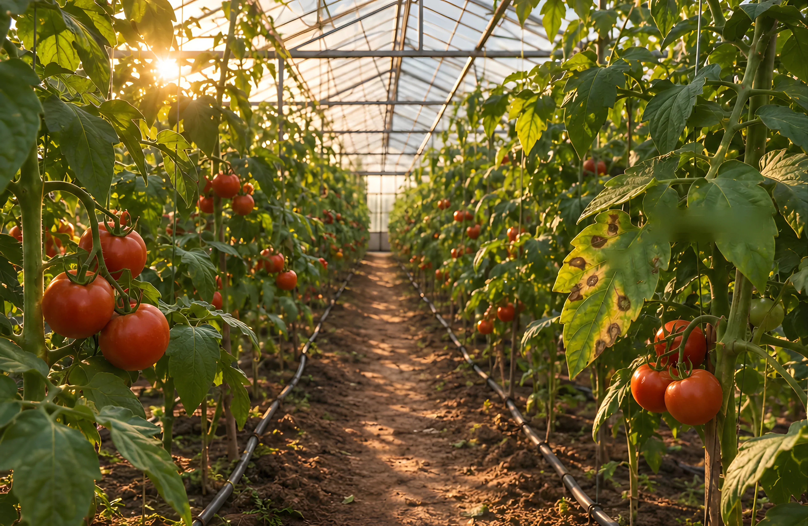

# CropScan XR intro, landing, and scroll

Copy the master prompt into your coding agent from the repository root. If the agent cannot read the repository, attach the three stills and both clips below along with the frontend code.

| Loading at 2.4 seconds | Settled landing at 7.2 seconds | Greenhouse artwork |
| --- | --- | --- |
|  |  |  |

[Landing intro video](demo/CropScan-XR-Landing-Intro.mp4) · [Greenhouse walk video](demo/CropScan-XR-Farm-Walk.mp4) · [5 fps reference analysis](../loading-video/Frame-by-Frame-Analysis.md)

## Copy-paste master prompt

```text
Reproduce the CropScan XR loading animation, landing hero, greenhouse walk, and per-page scroll reveals as one coherent interactive web experience. Work in the existing React/Vite frontend at Backend/frontend. Match the supplied references for composition and motion. Use the existing routes, assets, components, and real application data. Keep headings, forms, nav, progress, and buttons as live HTML.

REFERENCE ORDER

Use CropScan-XR-Landing-Intro.mp4 for the working intro and settled landing. Use CropScan-XR-Farm-Walk.mp4 for the scroll-driven camera path. Use frame-12_02.4s.jpg for the realistic single seedling, frame-36_07.2s.jpg for the arch and hero alignment, and greenhouse-aisle-4k.webp as the source for the tomato aisle. Inspect these files before editing. Use the existing IntroHero.jsx, src/three/intro/FieldIntro.jsx, src/three/intro/timeline.js, ScrollReveal.jsx, and index.css as implementation references.

1. LOADING TO LANDING

Match the reference at 1280 × 720 and recompose the same assets for portrait. Begin on warm peach with the terracotta pot, realistic soil, and soft contact shadow. Grow one plant from one rooted stem. Reuse intro-plant-growth.webp and its frame metadata so leaf silhouettes, veins, and stem registration follow the source. Hold the camera steady and preserve the pot position, light direction, and scale.

Use one readiness-gated clock for the plant, loading UI, aperture, and headline. Around 1.0 s show the first tip. At 2.4 s show the first leaf pair around 47%. At 4.2 s reach maturity and 100% once the assets are ready. At 5.4 s begin opening the narrow leaf-shaped aperture. At 5.8 s show the greenhouse through it. By 7.2 s resolve to the full clay arch and settled “From canopy to greenhouse.” copy. Keep the established left-hand text and actions and right-hand greenhouse composition on desktop. Preserve the same real “Detect Disease”, “See VR Demo”, and “Enter the field” actions.

2. LANDING TO GREENHOUSE WALK

Use the very same rendered arch and aisle when the user begins scrolling. The first scroll pose must equal the settled landing pose in framing, scale, color, lighting, crop, and aisle vanishing point. The camera holds there until the user scrolls.

Pin the scene beneath the sticky site header using normal document scrolling. Map 0–100% of the existing ~1.6 viewport-heights of travel to the camera path. Start by easing the camera toward the aisle’s vanishing point while the hero copy fades. Move through the clay opening. Let the near rim and tomatoes travel outward faster than the path and the far doorway. The aisle should fill the scene when the camera crosses the arch, then keep moving forward between the tomato rows. Use the same depth-projected greenhouse artwork on both sides of the threshold. Preserve natural wheel, trackpad, touch, and keyboard scroll, with scrolling back reversing the camera path. Release the sticky scene at the end of travel so “How it works” arrives on the next scroll. The URL stays on Home during the walk.

If the user starts scrolling during first-load growth, let the intro settle to the exact landing pose as soon as the scene is ready and use the current scroll position to continue. A stalled or unavailable scene should reveal the settled poster and allow normal scrolling.

3. REVEAL CONTENT WITHIN EACH PAGE

Use the existing shared ScrollReveal behavior on semantic sections in their normal page layouts. As each section first enters the viewport, fade it in while it rises 18 px over about 500 ms. Reveal its heading and content together. Use small staggered delays for the three Home walkthrough cards and crop shelf. Leave each section visible after its first reveal for that visit. Reserve its layout space from the beginning. Reveal immediately when a control receives keyboard focus.

Home continues through How it works, the supported-crop shelf, and the full list. Detect reveals the photo picker and the scan summary when it exists. Result reveals the evidence, guidance, Field handoff, and VR options. Field reveals the leaf viewer, crop chooser, symptoms, environment controls, and infection cycle. About reveals its metrics, pipeline, technical details, and dataset sections. VR Demo reveals its setup steps and artwork. Scrolling affects the active page while navigation links and buttons open their existing destinations.

4. ACCEPTANCE

At 1280 × 720 compare the intro against the reference every 0.2 seconds. Match the single-stem silhouette, pot placement, arch, headline position, and aisle vanishing point at the corresponding frames. Compare the last settled intro frame with the first frame of the scroll walk. Check the approach, crossing, inside view, and release at approximately 0%, 35%, 60%, and 100% scroll progress, plus the reverse trip. Check a portrait viewport, keyboard focus, real links, async scan results, reduced motion, and WebGL or observer fallback. Reduced motion uses the settled image and immediately readable page sections. Deliver the working site and report the checks and any visible differences from the references.

If a video preview is requested, record the implemented page. Hold the exact settled pose briefly, then drive the page with a smooth scroll trace through the arch and into the first two Home sections. Render the browser UI as part of the capture so the preview matches the real website.
```
