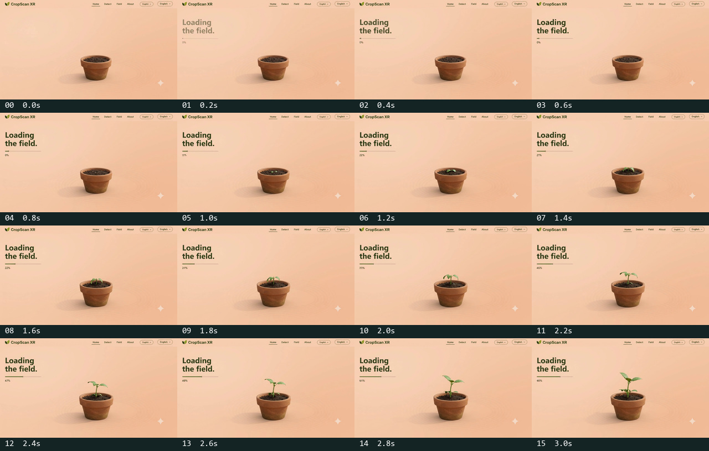
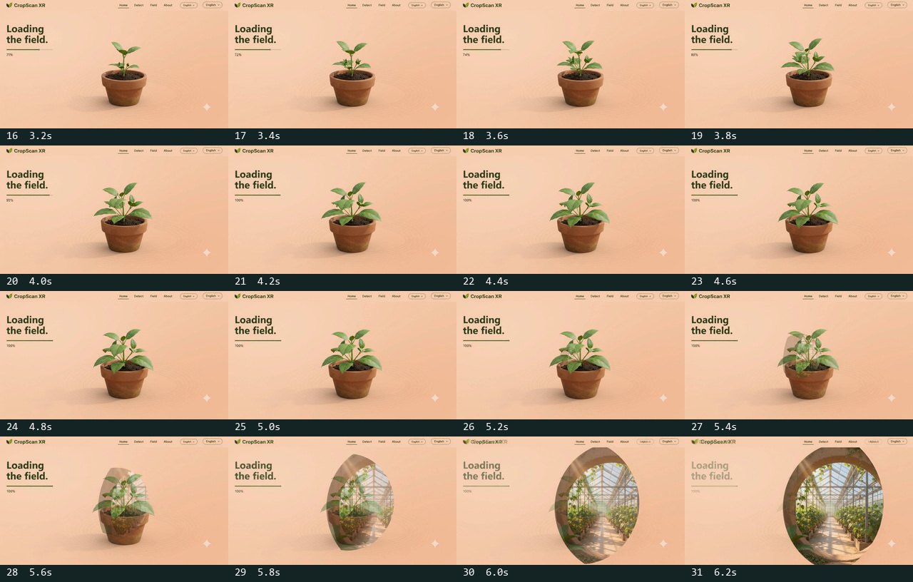
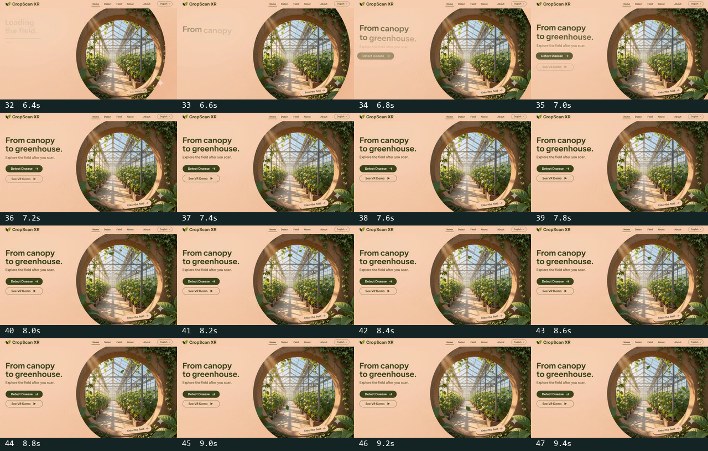

# CropScan XR frame-by-frame analysis

Sampled the supplied `gemini_generated_video_0c6bf75c.mp4` at 5 frames per second, using the nearest source frame every 0.2 seconds. The source video has 240 frames at 24 fps and a 1280 × 720 canvas. The 50 samples run from 0.0 through 9.8 seconds. The video stream ends at 10.0 seconds, and the MP4 container also carries a stereo audio track.

The source displays two **English** controls during loading. At about 6.0–6.2 seconds the wordmark briefly double-exposes, and the extra language control resolves into a second **About** in the final header. Some percentage digits shift or momentarily go backward. The website-ready prompt keeps one **About**, one **English** dropdown, a steady wordmark, a monotonic loader, and silent output. The reference images preserve the source as supplied.

## Opening and early growth · 0.0–3.0 seconds

| Time | Observation |
| --- | --- |
| [0.0 s](frames/frame-00_00.0s.jpg) | Header, peach background, and empty terracotta pot are visible. The left copy area is blank. |
| [0.2 s](frames/frame-01_00.2s.jpg) | The two-line loader, progress track, and 0% fade in at low opacity. |
| [0.4 s](frames/frame-02_00.4s.jpg) | The loader is clearly readable. The pot still shows only dark soil. |
| [0.6 s](frames/frame-03_00.6s.jpg) | The loader continues to settle, with the percent reading 0%. |
| [0.8 s](frames/frame-04_00.8s.jpg) | The percent still reads 0%, with a short olive mark at the start of the track. |
| [1.0 s](frames/frame-05_01.0s.jpg) | A green tip emerges at the center of the soil. The percentage is briefly distorted. |
| [1.2 s](frames/frame-06_01.2s.jpg) | The sprout opens close to the soil surface. The display reads 22%. |
| [1.4 s](frames/frame-07_01.4s.jpg) | The young leaves angle outward and the stem begins to lift. The display briefly reads 21%. |
| [1.6 s](frames/frame-08_01.6s.jpg) | The small leaves lift above the rim. The display returns to 22%. |
| [1.8 s](frames/frame-09_01.8s.jpg) | The stem lengthens and the upper leaf pair begins to separate. The bar is roughly a quarter full. |
| [2.0 s](frames/frame-10_02.0s.jpg) | The young plant gains height and a wider leaf span. The bar is roughly a third full. |
| [2.2 s](frames/frame-11_02.2s.jpg) | The leaf tips extend left and right. The display reads 45%. |
| [2.4 s](frames/frame-12_02.4s.jpg) | The stem is upright with two broad upper leaves and tiny basal leaves. The display reads 47%. |
| [2.6 s](frames/frame-13_02.6s.jpg) | The same two-leaf silhouette gets taller. The display reads about 49%. |
| [2.8 s](frames/frame-14_02.8s.jpg) | The upper leaves grow larger. Small lower leaves are easier to see. The display is around 60%. |
| [3.0 s](frames/frame-15_03.0s.jpg) | The main stem thickens and extends. The bar is around two-thirds full. |

## Plant maturity and greenhouse overlap · 3.2–6.2 seconds

| Time | Observation |
| --- | --- |
| [3.2 s](frames/frame-16_03.2s.jpg) | The upper leaf pair gets wider and lower growth begins to branch. The display reads 71%. |
| [3.4 s](frames/frame-17_03.4s.jpg) | Side leaves begin to spread on both sides below the upper pair. The display reads 72%. |
| [3.6 s](frames/frame-18_03.6s.jpg) | The lower leaves fan out and the upper foliage broadens. The display reads 74%. |
| [3.8 s](frames/frame-19_03.8s.jpg) | The canopy widens rapidly, with several broad leaves extending beyond the rim. The display reads 88%. |
| [4.0 s](frames/frame-20_04.0s.jpg) | The multi-leaf plant is nearly mature. The display reads 99%. |
| [4.2 s](frames/frame-21_04.2s.jpg) | The progress display reaches 100%. The plant has a broad canopy with clearly visible veins. |
| [4.4 s](frames/frame-22_04.4s.jpg) | The loader holds at 100%. The mature foliage settles. |
| [4.6 s](frames/frame-23_04.6s.jpg) | The plant, clay rim, and soil stay visible. The 100% loader holds. |
| [4.8 s](frames/frame-24_04.8s.jpg) | The mature plant remains centered slightly right of the viewport midpoint. |
| [5.0 s](frames/frame-25_05.0s.jpg) | The full bar and mature plant remain visible over the faint concentric floor rings. |
| [5.2 s](frames/frame-26_05.2s.jpg) | The 100% hold continues. The plant still reads as the primary subject. |
| [5.4 s](frames/frame-27_05.4s.jpg) | The first faint leaf-shaped greenhouse image overlays the mature plant. |
| [5.6 s](frames/frame-28_05.6s.jpg) | The translucent opening grows taller. Roof framing is visible through the plant. |
| [5.8 s](frames/frame-29_05.8s.jpg) | The opening reaches above the plant and below the pot rim. The plant and greenhouse remain superimposed. |
| [6.0 s](frames/frame-30_06.0s.jpg) | The aperture grows toward the top and bottom. The aisle is readable, the plant is fading, and the wordmark briefly ghosts. |
| [6.2 s](frames/frame-31_06.2s.jpg) | The arch widens toward the right. The original loader is washed out and the pot is nearly gone. |

## Landing reveal and drifting leaves · 6.4–9.4 seconds

| Time | Observation |
| --- | --- |
| [6.4 s](frames/frame-32_06.4s.jpg) | The greenhouse becomes dominant. The loader is very faint and the cream portal button begins to appear. |
| [6.6 s](frames/frame-33_06.6s.jpg) | The loader has cleared. The first line of the new headline and the Enter the field pill are visible. |
| [6.8 s](frames/frame-34_06.8s.jpg) | The second headline line, subtitle, and filled Detect Disease button fade in. |
| [7.0 s](frames/frame-35_07.0s.jpg) | The outlined See VR Demo button appears. The title and primary action are largely opaque. |
| [7.2 s](frames/frame-36_07.2s.jpg) | The landing layout is fully legible. The large arch holds its right-side composition. |
| [7.4 s](frames/frame-37_07.4s.jpg) | The final hero holds as the CTA stack settles. |
| [7.6 s](frames/frame-38_07.6s.jpg) | The completed hero and bright central aisle hold. |
| [7.8 s](frames/frame-39_07.8s.jpg) | The settled hero holds before the free leaves are clearly visible across the upper window. |
| [8.0 s](frames/frame-40_08.0s.jpg) | Detached leaves appear near the upper glass roof. |
| [8.2 s](frames/frame-41_08.2s.jpg) | Small leaves cross the upper-left and center roof framing. |
| [8.4 s](frames/frame-42_08.4s.jpg) | The upper leaves drift farther across the glass, changing orientation. |
| [8.6 s](frames/frame-43_08.6s.jpg) | A detached leaf remains near the upper-left of the opening while another is visible lower against the greenhouse plants. |
| [8.8 s](frames/frame-44_08.8s.jpg) | A visible leaf moves along the right side of the opening. |
| [9.0 s](frames/frame-45_09.0s.jpg) | A larger foreground leaf becomes visible low on the left side of the aisle. |
| [9.2 s](frames/frame-46_09.2s.jpg) | The lower foreground leaf rotates and passes across the center of the aisle. |
| [9.4 s](frames/frame-47_09.4s.jpg) | The foreground leaf continues toward the lower right of the aisle. Smaller leaves remain higher up. |

## Final sampled frames · 9.6–9.8 seconds

| Time | Observation |
| --- | --- |
| [9.6 s](frames/frame-48_09.6s.jpg) | Several leaves pass through the opening at different depths, while the layout stays fixed. |
| [9.8 s](frames/frame-49_09.8s.jpg) | Final sampled frame. The page remains fully visible with drifting leaves in front of the greenhouse. |

