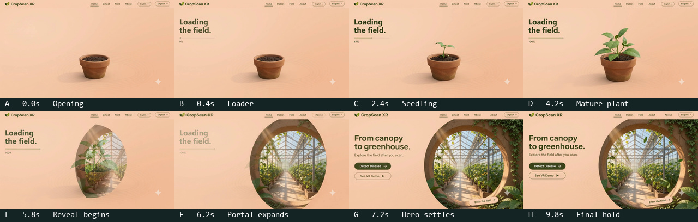
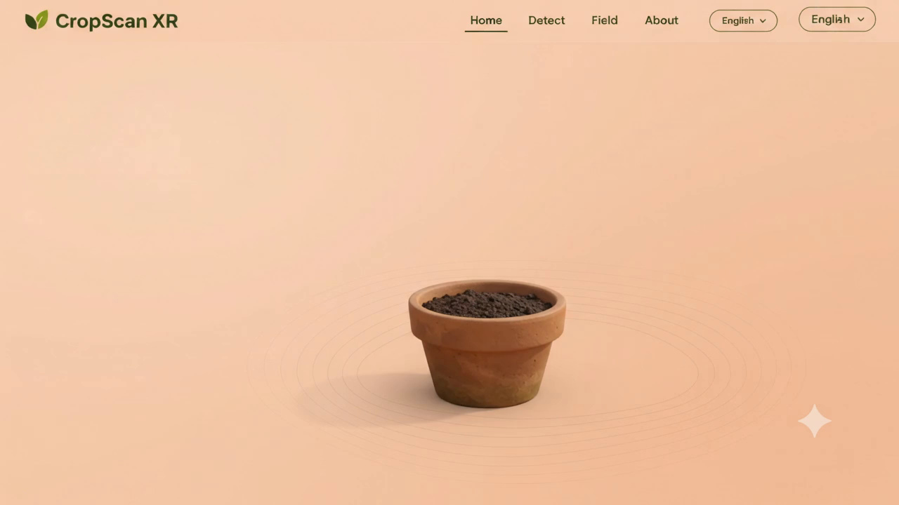
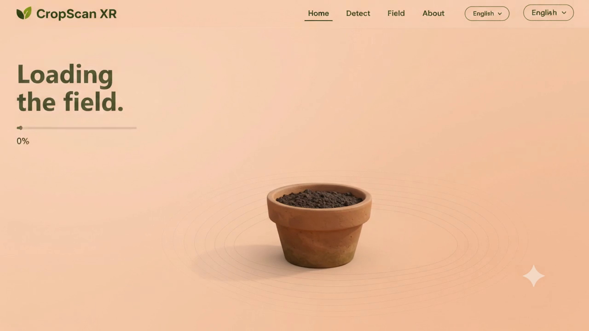
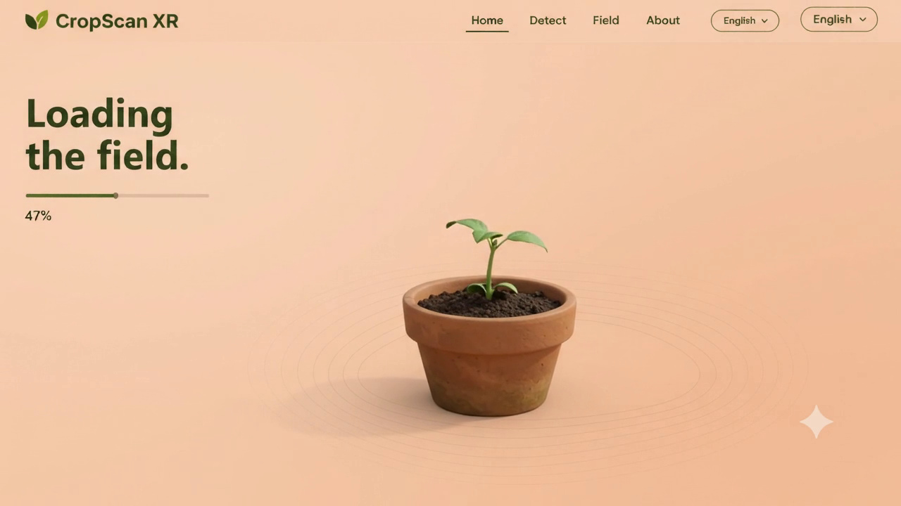
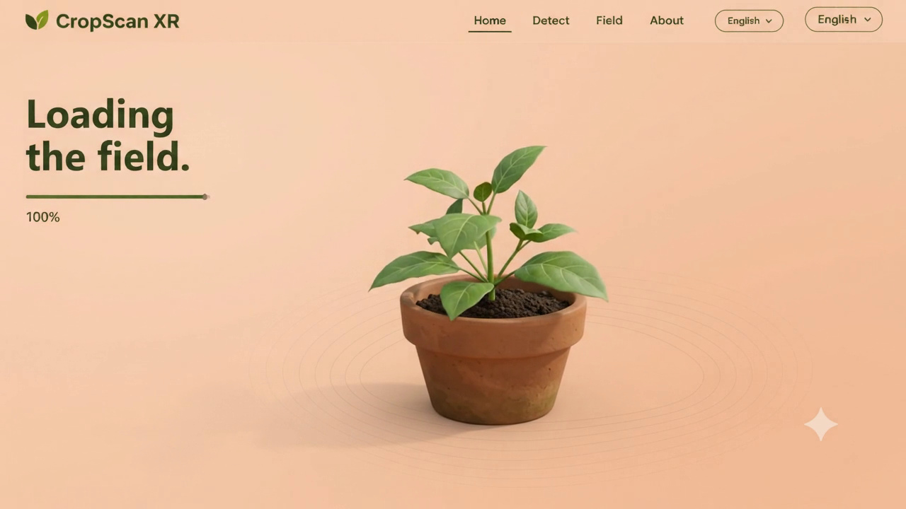
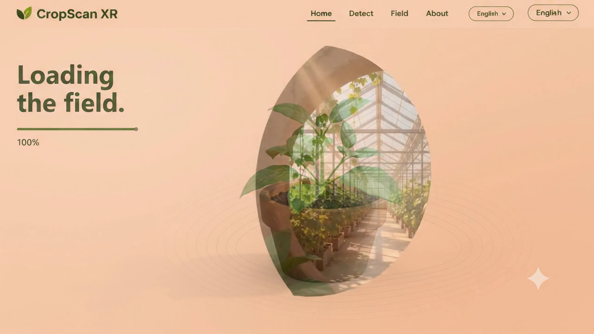
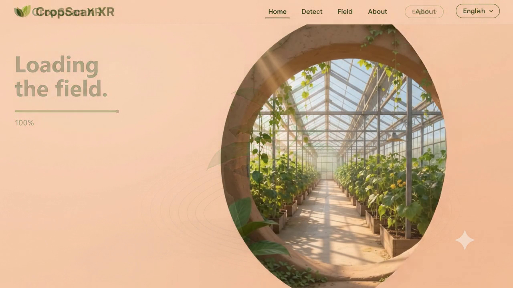
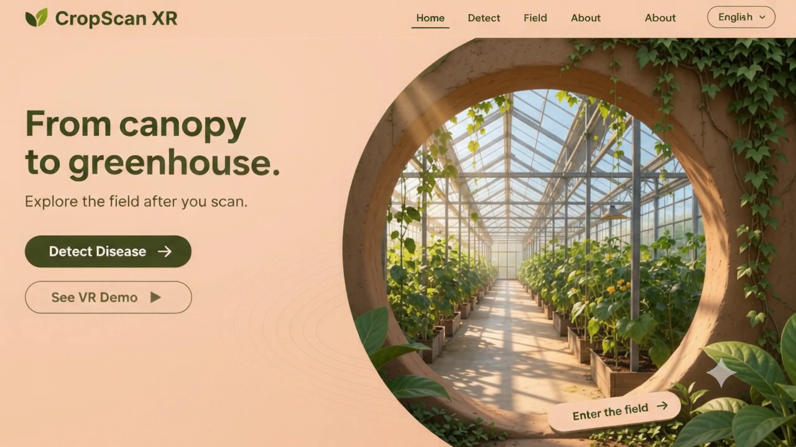
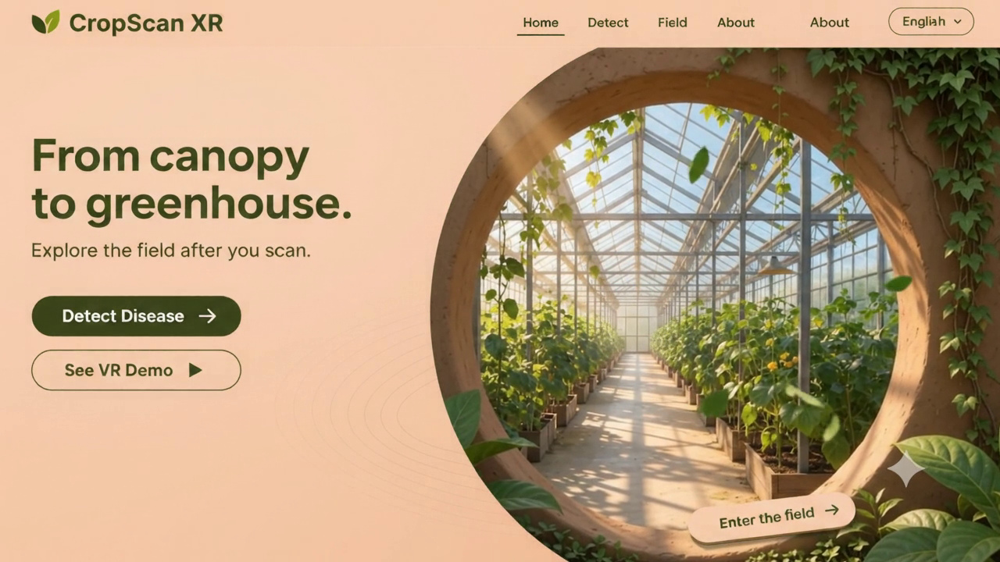

# CropScan XR loading-to-landing video

Copy the **Master prompt** below into your video generator and upload the reference frames A–H in order. The storyboard is an overview. Upload the individual images for generation so the model can read the layout at full size. If your editor only offers start and end frame inputs, use A and H. If it accepts a source video, provide the original MP4 as the motion reference as well.

## Master prompt

Create a 10.0-second, 1280 × 720, 16:9, 24 fps, silent website loading-to-landing video for **CropScan XR**. Match the attached images A–H at their specified times. Treat the source frames as composition, lighting, object continuity, typography, and motion references. Produce a single seamless shot with a locked front-facing viewport. Start directly on the website canvas. End on the fully visible landing screen and play once.

### Composition and visual continuity

- Fill the frame with a softly textured peach-to-apricot gradient, pale around the left copy area and warmer toward the lower right. Reference colors are approximately `#F5D2B4` and `#EFBD9A`. Typography and controls are dark olive with a muted green progress fill.
- Keep a slim peach header about 60 px high. At x ≈ 36 px place a two-leaf olive logo and the bold wordmark **CropScan XR**. Align **Home**, **Detect**, **Field**, **About** and one outlined **English** dropdown on the right. Underline **Home**. Keep all navigation stationary and legible throughout the transition.
- Place the terracotta pot around x ≈ 695 px, with the base around y ≈ 585 px. The empty pot is about 228 px wide. Use a broad rolled rim, a tapered base, subtle brown weathering, and coarse dark soil. Give it a soft, low shadow stretching left. Set thin, faint peach concentric perspective rings on the floor around the base. Keep the ivory four-point sparkle near x ≈ 1160, y ≈ 600 px.
- Use a heavy, rounded sans-serif for the headline, around 56 px with tight line spacing. Keep the left copy anchored around x ≈ 37–40 px. Keep the pot centered on the same soil point through growth, with at most the subtle scale change visible in the source.

### Timeline and keyframe directions

| Time | Direct the shot |
| --- | --- |
| **0.0–0.8 s · A → B** | Frame A has the header, empty soil-filled pot, shadow, floor rings, and sparkle. The left side starts blank. Fade in the two-line headline **Loading** / **the field.** at x ≈ 37, y ≈ 135 px. Below it place a 260 px-wide, thin light-tan track around y ≈ 278 px, an olive fill with a small round tip, and **0%** below at y ≈ 300 px. The text is faint at 0.2 s and clearly visible by 0.4–0.6 s. |
| **0.8–2.4 s · B → C** | A small green shoot emerges from the middle of the soil around 1.0 s. Its first pair of leaves unfold and rise as the stem lengthens. At 2.4 s match C, with a slim upright stem, two broad upper leaves, tiny basal leaves, and progress near **47%**. Keep the floor, pot, and text positions steady. |
| **2.4–4.2 s · C → D** | Grow the same stem continuously. Add side stems and broad, pointed oval leaves with visible veins. Leaves unfold from the stem and fan outward rather than popping into place. The displayed progress is about **70% at 3.2 s**, **90% at 3.8 s**, and **100% at 4.2 s**. Match D's mature foliage, about 340 px wide, and keep the dark soil and clay rim visible. |
| **4.2–5.4 s · D hold** | Hold the mature plant over the same pot. Keep the loader at **100%** with a full olive bar and allow a nearly imperceptible leaf settle. Around 5.4 s the first faint greenhouse shape overlaps the plant. |
| **5.4–6.4 s · E → F** | Open a soft-edged, upright leaf-shaped aperture behind and through the plant. At 5.8 s match E, with the semi-transparent greenhouse and the still-visible plant overlapping. Expand the aperture up, down, and especially right while softly dissolving the plant and pot. Around 6.2 s match F, with the growing round arch and bright aisle taking over center-right while the loader fades. By about 6.4 s the portal nears full size and touches the top of the hero below the header and the bottom edge. |
| **6.4–7.2 s · F → G** | Complete the circular reveal to the right edge. Fade out the old headline, progress bar, and percentage. Around 6.6 s bring in **From canopy**, around 6.8 s reveal **to greenhouse.**, then the subtitle and primary button. Bring in the outlined secondary button last. Keep the cream **Enter the field** pill over the lower arch, visible by about 6.6 s. Settle the entire hero by 7.2 s. |
| **7.2–10.0 s · G → H** | Hold the finished hero and all text in place. From around 7.8–8.0 s, let a few individual green leaves drift and rotate lazily through the greenhouse, at varying depths and with light motion blur. Match H's final composition. Hold the final hero to the last frame, with no cut to black or restart. |

### Final landing frame

- Left column at x ≈ 40 px. Set the headline at y ≈ 170 px on two lines, **From canopy** and **to greenhouse.** Under it around y ≈ 311 px place **Explore the field after you scan.**
- Stack two rounded pills near y ≈ 379 and 448 px, each about 269 × 53 px. The first is filled dark olive and reads **Detect Disease**, with a cream right arrow. The second has a thin olive outline and reads **See VR Demo**, with a small olive play triangle.
- The right hero begins around x ≈ 550 px at its widest point and is clipped by the right and bottom edges. Reveal a thick warm ochre arch with ivy along the upper-right and foreground leaves along the lower-right. Inside, show a bright, realistic greenhouse with a central aisle in one-point perspective, plant rows in wooden planters, small yellow blossoms, a glass-and-steel roof, and warm sunlight from the upper left casting diagonal shadows onto the aisle.
- Lay a tilted pale-peach **Enter the field** pill with an olive right arrow on the lower arch, roughly x ≈ 880–1095 px and y ≈ 630–695 px. Preserve the faint concentric rings in the open peach area near the arch.

Keep the typography crisp and the progress count monotonic. Avoid duplicate navigation items, logo ghosting, drifting text, abrupt edits, camera moves, neon portal effects, heavy particle effects, and added copy. Keep the greenhouse lighting and perspective fixed while the opening expands. Use the supplied images as visual references and leave their filenames and timestamp labels out of the render.

## Reference images to upload

### A · 0.0 s · Opening canvas

### B · 0.4 s · Loading layout

### C · 2.4 s · Mid-growth

### D · 4.2 s · Mature plant

### E · 5.8 s · Plant and greenhouse overlap

### F · 6.2 s · Expanding aperture

### G · 7.2 s · Landing page

### H · 9.8 s · Final hold

## Website handoff

For a playable intro with an identical picture, use the source MP4. For an interactive landing page, use the video for the plant and greenhouse artwork and put the navigation, loading text, progress bar, and buttons in HTML. When generating a clean background plate for that implementation, keep the artwork and timing above and omit all rendered type and buttons. Match the live hero to H so the video can hand off to the page without a visible jump.
